<div align="center">


<br />

<a href="https://hoodstories.pl"></a>


</div>

<br />


<table>
<tr>
<td width="57%" valign="top">

**I build systems that feel like they belong on the server.**
Not another menu, not another disconnected resource: gameplay, backend, database and interface designed as one thing.

I'm a FiveM developer building for **[HoodStories](https://hoodstories.pl)**. Most of my work lives inside the police department: the MDT, forensics, ANPR cameras, the prison and the events that tie them together. On the side I build web panels for the server's staff.

- 🔭 currently building **hs-prison 2.0**
- ⚡ resmon-obsessed, idle target **0.00–0.01 ms**
- 🛡️ server-authoritative by default, tested before prod
- 🎧 vibing through bug reports since 2025

</td>
<td width="43%" valign="top">

```yaml
alias:   VibingCat7111
github:  vibingcat532
role:    FiveM developer
server:  HoodStories RP
focus:
  - police systems
  - backend & SQL
  - NUI / UX
  - web panels
langs:   [lua, ts, js, sql]
status:  shipping
```

</td>
</tr>
</table>



<p align="center"><sub>hs-mdt is the hub: ANPR hits, 10-13 panics, prison breaks and event calls all land in the same dispatch feed.</sub></p>


<p align="center">
  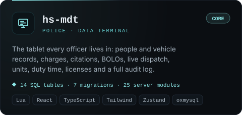
  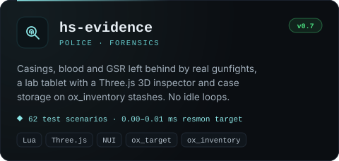
</p>
<p align="center">
  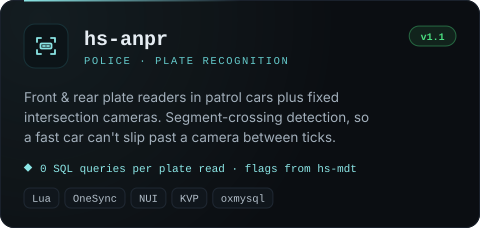
  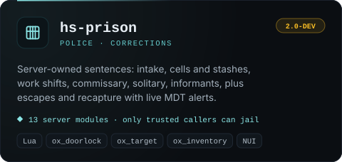
</p>
<p align="center">
  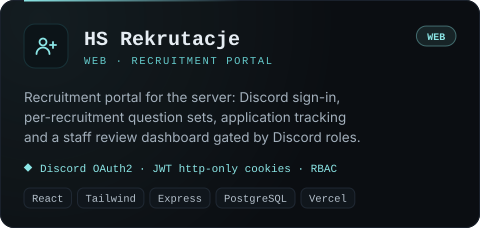
  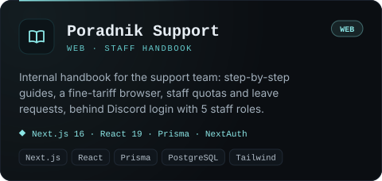
</p>

<p align="center"><sub>🔒 private repositories, built for and running on <a href="https://hoodstories.pl">HoodStories</a></sub></p>


| | resource | what it does |
|:-:|:--|:--|
| 🎃 | **hs-october** | Halloween event: candy exchange, TOP 10 ranking, a daily killer boss |
| 🌒 | **hs-nocnazmiana** | Horror night shift for the police, with hallucinations and MDT calls |
| 💥 | **hs-flashbang** | Whiteout, WebAudio tinnitus, weapon lock, all validated server-side |
| 👻 | **hs-jumpscare** | Five horror encounters for admins, with audio fallbacks |
| 🥊 | **vib-fightclub** | Fist-fight arena: queue, paired matches, KO / draw and bets |
| 💈 | **hs-barber** | Barbershop job with chairs, staff lockers and its own NUI |
| 🔫 | **hs-gunsmoke** | Client-only muzzle smoke and flash, zero server cost |
| 🛡️ | **vib-balistic** | Ballistic shield for the police department |


<p align="center">
  
  <br />
  
</p>

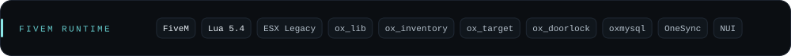


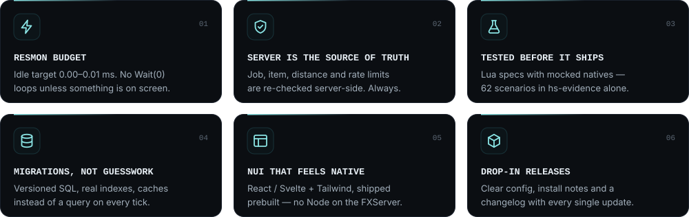

```diff
@@ standards.md · keep (+) / drop (-) @@
+ interfaces with a clear hierarchy
+ systems with a purpose
+ backend you can reason about
+ sensible database structure
+ responsive, consistent UX
- copy-paste resource stacks
- UI for the sake of UI
- logic hidden in random callbacks
- unnecessary dependencies
- "works on my machine"
```


<picture>
  <source media="(prefers-color-scheme: dark)" srcset="https://raw.githubusercontent.com/VibingCat532/VibingCat532/output/snake-dark.svg" />
  
</picture>

